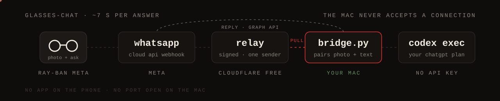

Look at something and ask about it out loud. The glasses take the photo and
send it, with your question, to a WhatsApp contact. That contact is a bot: a
small relay on Cloudflare's free tier holds the message, a bridge on your Mac
picks it up, asks Codex on the ChatGPT plan you already pay for, and replies on
WhatsApp. The glasses read the reply in your ear. No app on the phone, no API
key, no port open on the Mac.

[](LICENSE)
[](#requirements)
[](https://github.com/vidoluco/glasses-chat/actions/workflows/ci.yml)

## What you say

| To the glasses | What happens |
|---|---|
| "Hey Meta, take a photo and send it to Tony" | the photo waits up to 20 seconds for its question |
| "Hey Meta, send a message to Tony saying what plant is this?" | answered about the photo if it came in the last 90 seconds, otherwise as plain text |
| a photo and nothing else | after 20 seconds it answers "What am I looking at?" |

"Tony" is just the name you give the bot in your address book. Pick something
short that speech recognition will not confuse with a real contact.

## Status

Verified on real glasses: a question spoken to the glasses reaches the bot and
the answer is read aloud, in about 6 seconds for general knowledge and about
12 when it needs a web search (weather, news, opening hours). Photo questions
are verified with typed messages (about 7 seconds); by voice they are next. If
the glasses say they cannot find the contact, see [Limits](#limits).

## How it works



<details>
<summary>The same pipeline as text</summary>

```
glasses ──"Hey Meta, send it to Tony"──► WhatsApp (Cloud API test number)
                                              │ webhook, signed by Meta
                                              ▼
                                         relay/worker.js on Cloudflare Workers
                                           checks the X-Hub-Signature-256
                                           keeps messages from one number only
                                           stores them in a Durable Object
                                              ▲
                                              │ GET /pull every 2 s (outbound only)
                                         server/bridge.py on your Mac
                                           downloads the photo from Meta
                                           pairs it with the next text message
                                           codex exec "<prompt>" -i photo.jpg
                                              │
glasses ◄──read aloud── WhatsApp ◄──Graph API reply──┘
```

</details>

## Why it exists

Meta AI on the glasses is region-locked: in some countries camera questions
just get "not available in your region". The glasses' own features still work
there, including sending photos and messages on WhatsApp and reading replies
aloud. This uses those features as the transport and puts your own model
behind them.

- **No phone app.** A native app built on Meta's Wearables Device Access
  Toolkit needs a paid Apple developer account to run on a managed iPhone.
  WhatsApp is already on the phone.
- **No API key.** `codex exec` runs with your ChatGPT login. Swap in any other
  CLI by editing one function in `server/server.py`.
- **No inbound port.** The relay is the only public endpoint. The Mac polls it.

## Requirements

- Ray-Ban Meta glasses paired with the Meta AI app, WhatsApp connected under
  Calling & messaging.
- A Mac with Python 3.10+ and the [Codex CLI](https://github.com/openai/codex)
  signed in.
- A Meta developer account and a Cloudflare account, both free.
- Node 18+ for `wrangler` and the relay tests.

## Setup

**1. Meta.** At [developers.facebook.com](https://developers.facebook.com)
create an app with the "Connect with customers through WhatsApp" use case. Under
API Setup note the test number's *Phone number ID*, add your own number as a
recipient, and generate an access token. Note the *App Secret* under App
settings > Basic. The token from API Setup lasts 24 hours; for daily use create
a system user in Business Settings and give it a token with
`whatsapp_business_messaging`.

**2. Relay.**

```
cd relay
npx wrangler deploy
npx wrangler secret put APP_SECRET     # the Meta app secret
npx wrangler secret put VERIFY_TOKEN   # any random string
npx wrangler secret put PULL_TOKEN     # another random string, used by the bridge
npx wrangler secret put ALLOWED_FROM   # your number, digits only, e.g. 15550001111
```

Point the webhook at it and subscribe to `messages`:

```
curl -X POST "https://graph.facebook.com/v25.0/$APP_ID/subscriptions" \
  --data-urlencode "access_token=$APP_ID|$APP_SECRET" \
  -d object=whatsapp_business_account -d fields=messages \
  --data-urlencode callback_url=https://<worker>.workers.dev/webhook \
  --data-urlencode verify_token=$VERIFY_TOKEN
curl -X POST "https://graph.facebook.com/v25.0/$WABA_ID/subscribed_apps" \
  -H "Authorization: Bearer $WHATSAPP_TOKEN"
```

**3. Bridge.** Create `~/.config/glasses-chat/whatsapp.json`, mode 600:

```json
{
  "relay_url": "https://<worker>.workers.dev",
  "pull_token": "<PULL_TOKEN>",
  "whatsapp_token": "<token>",
  "phone_number_id": "<Phone number ID>"
}
```

```
cd server && GLASSES_LANGUAGE=English python3 bridge.py
```

Save the test number in your address book under the name you will say to the
glasses, send it a message, and you should get an answer back.

<details>
<summary>Run it as a login service (launchd)</summary>

Keep `bridge.py` running with a LaunchAgent: `ProgramArguments` pointing at
`python3 -u bridge.py`, `WorkingDirectory` at `server/`, `KeepAlive` true, and
a `PATH` that includes the directory holding `codex`. With the python.org build
of Python also set `SSL_CERT_FILE=/etc/ssl/cert.pem`: it ships without CA
certificates.

</details>

## Configuration

| Variable | Default | |
|---|---|---|
| `GLASSES_LANGUAGE` | the language of the question | language of the spoken answer |
| `GLASSES_PHOTO_WAIT` | `20` | seconds a photo waits for its question |
| `GLASSES_PAIR_WINDOW` | `90` | a question this soon after a photo is about that photo |
| `GLASSES_POLL` | `2` | seconds between pulls from the relay |
| `GLASSES_MAX_CHARS` | `100` | longer answers are cut to the first sentence: past some length the glasses only announce "a long message" |
| `GLASSES_WEB_SEARCH` | `1` | live web search when the question needs current facts; `0` turns it off |
| `GLASSES_MODEL` / `GLASSES_EFFORT` | Codex default / `low` | model and reasoning effort |

## What leaves the Mac

The photo and the question travel through WhatsApp and Meta's Cloud API, wait
in the relay until the Mac collects them, and go to OpenAI through `codex exec`, which may run a web search for questions about current facts.
The relay deletes each message once the bridge acknowledges it. The Mac writes
nothing to disk but the bridge log. See [SECURITY.md](SECURITY.md).

## Limits

- **Contact lookup on the glasses.** The glasses resolve names through the
  phone's address book as the Meta AI app last read it, so a contact added a
  minute ago may not be found by voice yet. Turning the Meta AI app's Contacts
  permission off and on, then reopening the app, forces a re-read.
- **Test number.** Meta's free test number talks to at most five recipients you
  verify. One person needs one.
- **No wake word of its own.** It is "Hey Meta", then the contact's name. A
  custom wake word needs a native app.
- **Two utterances.** Photo, then question. A caption on the photo answers in
  one go, but the glasses do not add captions by voice.
- **Voice notes** are not transcribed yet: the bot asks for text instead.

## Tests

```
cd server && python3 -m unittest test_bridge test_server   # pairing, media, replies, speakable text
node --test relay/worker.test.mjs               # signature, allow-list, dedup, pull and ack
```

## License

[MIT](LICENSE)
